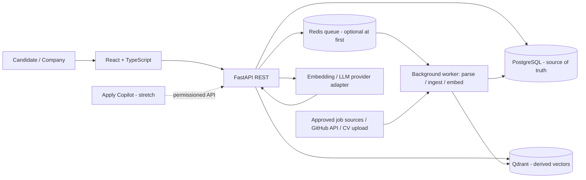

# Arquitectura objetivo (propuesta)

Estado: `PROPOSED`. No implementar la arquitectura a ciegas hasta completar auditoría legacy y aprobar ADRs.

## Contexto

## Límites de módulos

- `identity`: identidad, roles y autorización.
- `candidates`: perfiles, habilidades, preferencias, CV metadata y referencias de proyectos.
- `companies`: datos de organización y miembros.
- `jobs`: ofertas canonizadas, fuentes, expiración y duplicados.
- `ingestion`: conectores, frecuencia, normalización, trazas y errores.
- `documents`: uploads, parsing, almacenamiento temporal y retención.
- `github_evidence`: cliente API, límites de tasa, resultados enlazados y procedencia.
- `matching`: embeddings, filtros, candidatos top-k, ranking y explicación.
- `interactions`: intereses, match mutuo, etapas y acceso de contacto.
- `rag`: recuperación autorizada y generación con citas/fuentes.
- `agent_assist`: sugerencias editables de perfil, carta y preparación de entrevista.
- `audit`: eventos relevantes, consentimiento y overrides.
- `application_tracker`: registro manual/confirmado de candidaturas.
- `browser_extension`: producto opcional separado del backend principal.

## Fuentes de verdad

- PostgreSQL: datos canónicos, usuario, permisos, ofertas, interacción, consentimiento, auditoría y estado del trabajo.
- Qdrant: índice derivado de vectores con metadatos mínimos; eliminar/recalcular al actualizar o suprimir la fuente.
- Redis: cola/cache volátil; no es fuente de verdad.
- Object storage local/dev: solo para desarrollo. En despliegue real, definir un almacenamiento privado con control de acceso, expiración y cifrado.
- Logs: diagnósticos mínimos; nunca CV completo, tokens, prompts con PII por defecto o respuestas sensibles.

## API y seguridad

- API REST con OpenAPI y modelos Pydantic.
- Autorización servidor para todo recurso por usuario/empresa/tenant.
- Endpoints públicos limitados, límites de tasa y validación de uploads.
- No confiar en el frontend para la vista ciega ni el interés mutuo.
- Datos de terceros tratados como contenido, no como instrucciones (mitigación prompt injection).

## Flujo matching

1. Canonizar la oferta y el perfil autorizado.
2. Aplicar filtros estructurados estrictamente pertinentes (ubicación/modalidad, elegibilidad esencial si corresponde y explícita; nunca filtros discriminatorios).
3. Recuperar candidatos/ofertas por Qdrant y/o búsqueda textual.
4. Combinar con evidencia de skills/proyectos y el modelo/ranking aprobado.
5. Calcular explicación a partir de factores deterministas y evidencias disponibles; no permitir que el LLM invente factores.
6. Guardar modelo/config/versión relevantes; exponer incertidumbre y permitir corrección/override humano.

## RAG

- Corpus autorizado de páginas corporativas/ofertas/preguntas y fuentes identificadas.
- ACL aplicada antes de recuperar contexto, no solo después de generar la respuesta.
- Instrucciones del usuario separadas de documentos recuperados; documentos externos no pueden invocar herramientas.
- Respuesta con fuentes, fecha, fallback si hay evidencia insuficiente y tests de inyección.

## Rendimiento

- No calcular embeddings dentro de una petición de listado si pueden precomputarse al actualizar perfil/oferta.
- Medir p50/p95/p99; separar `embedding`, `vector retrieval`, `reranking` y `LLM generation`.
- Índices, caché y workers se añaden tras benchmark; el retrieval <300 ms se verifica sobre corpus y hardware documentados.

## Despliegue inicial

Monolito modular FastAPI + frontend React, PostgreSQL, Qdrant y worker cuando se requieran tareas persistentes. Docker Compose para local/integración; despliegue real con secretos, TLS, copias de seguridad, restauración probada, alertas y entornos separados. No usar microservicios antes de que exista una necesidad observada.
