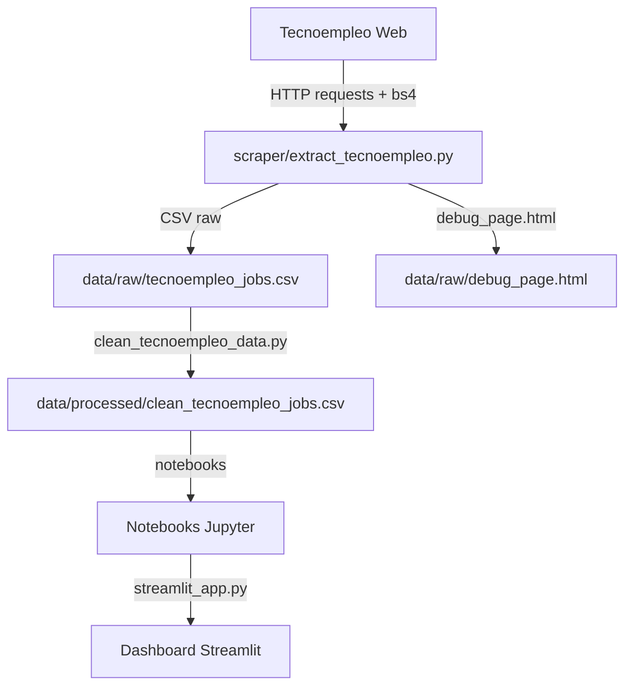

# Entregable 2 — Mapa de arquitectura y flujo de datos

Estado: Completo (evidencia estática, ejecución no autorizada en fase 0)

## Arquitectura observada (legacy real)

```
[Tecnoempleo.com]  →  [scraper: requests + bs4]  →  CSV raw (data/raw/tecnoempleo_jobs.csv)
                                                                  ↓
                                                          [cleaner: pandas + regex]
                                                                  ↓
                                                    CSV processed (data/processed/)
                                                                  ↓
                                                    [Notebooks: pandas, plotly, seaborn]
                                                                  ↓
                                                    [Dashboard: Streamlit]
```

Nota: No hay base de datos, no hay API REST, no hay almacenamiento persistente relacional, no hay pipeline de embeddings, no hay sistema RAG, no hay autenticación ni roles.

## Diagrama Mermaid



## Componentes verificados y no verificados
- Scraper (B): Verificado (código leído completo, no ejecutado por restricción).
- Limpieza (D): Verificado (código leído completo).
- Notebooks (E): No verificados (no abiertos/en ejecución).
- Dashboard (F): No verificado a fondo (solo referencia en README y estructura de directorio).

## Entradas / salidas
- Scraper: Entrada = URL de Tecnoempleo; Salida = CSV con `titulo`, `empresa`, `ubicacion`, `salario`, `tipo_contrato`, `skills`, `busqueda`, `url`.
- Limpieza: Entrada = CSV raw; Salida = CSV limpio con `modalidad`, `ciudad`, `skills` normalizadas, `salario_min`, `salario_max`, `salario_medio`, `es_outlier`.
- Notebooks: Entrada = CSV limpio + dataset DS Salaries (según README); Salida = visualizaciones, estadísticas, análisis de sesgos.
- Dashboard: Entrada = datos procesados + datos sintéticos de usuario (CV PDF o texto plano según README); Salida = interfaz visual interactiva (no verificada completamente en ejecución).

## Diferencias con arquitectura documentada en PDF de Somos F5
La arquitectura del proyecto final (FR-01 a FR-11, NFR-01 a NFR-09) requiere:
- Roles y perfiles con CRUD en base de datos relacional (PostgreSQL)
- Matching semántico con embeddings (BGE-Large / OpenAI)
- Base vectorial (Qdrant / Pinecone)
- RAG y asistente con LangChain / LlamaIndex
- Sistema multi-agente (LangGraph)
- Blind hiring (anonimización temprana)
- Dashboard de empresa con métricas
- FastAPI / React

El legacy no implementa ninguna de estas funcionalidades. Es un pipeline de análisis de datos con dashboard local.

## Puntos de acoplamiento y fallos potenciales
- Scraping depende de estructura HTML fija de Tecnoempleo; cualquier cambio rompe el scraper.
- No hay validación de integridad del CSV generado ni validación de esquema.
- No hay reintentos ni manejo de errores robusto en limpieza (solo `try/except` básico en scraping).
- No hay control de versiones en datos procesados.
- No hay separación de datos sensibles ni control de acceso.
